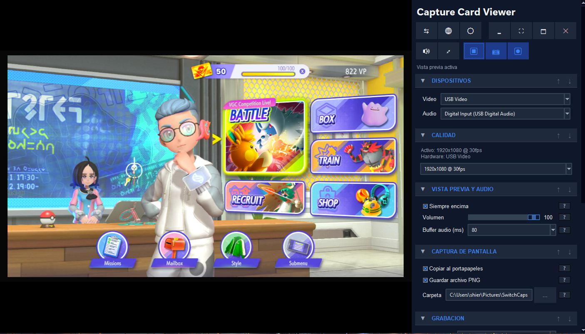

# CCV — Capture Card Viewer

**Play and record your Switch, PS5, Xbox or any USB capture card directly inside Windows — no second TV, no extra HDMI input, no streaming overlay.**

Plug your console into a USB capture card, plug the card into your PC, open CCV, and your console runs in a window on your desktop. Play it like any other game, record clips when you want, screenshot with PrintScreen. Uses about 50 MB of RAM, opens in a couple of seconds, and keeps itself up to date.

## Why CCV

You bought a capture card so you could play your console on your monitor (because the TV is busy, the kids are asleep, you only have the one display, your console lives in another room, whatever). The two existing options for actually doing that are:

- **OBS** — built for streamers. Powerful, but you have to set up a scene, configure sources, fight with the canvas, and it idles at 300+ MB of RAM.
- **The vendor app that came with your card** — usually clunky, sometimes broken on modern Windows, and most of them have ads or upsells now.

CCV is the in-between. Open the window. See your console. Play. Record when you want a clip. Hit PrintScreen when you want a screenshot. Close it when you're done. That's the entire app.

## Get it

Pick one. All of them bundle everything CCV needs (including ffmpeg); nothing else to install.

| Download | What it is |
|---|---|
| **[⬇ Installer — `ccv-setup.exe`](https://github.com/manucruzleiva/ccv/releases/latest/download/ccv-setup.exe)** | Recommended. Installs for your user only (no admin rights), adds a Start-menu entry and an uninstaller. Fastest startup. |
| **[⬇ Portable — `ccv-portable.zip`](https://github.com/manucruzleiva/ccv/releases/latest/download/ccv-portable.zip)** | Unzip anywhere (a USB stick, a synced folder) and run `ccv.exe`. Settings are saved in that folder, not on the PC. |
| **[⬇ Single file — `ccv.exe`](https://github.com/manucruzleiva/ccv/releases/latest/download/ccv.exe)** | One ~135 MB file, double-click to run. Takes a second or two longer to open. |

Requires Windows 10 or 11 (64-bit). Checksums for every file are in `SHA256SUMS.txt` on the [release page](https://github.com/manucruzleiva/ccv/releases/latest).

**Updates:** CCV tells you when a new version is out (a small notice and an **Install** link in the **System** panel). Click it and CCV downloads the update, checks it, restarts and you're on the new version. It only talks to GitHub to ask for the latest version number, never sends anything about you, and you can switch the check off.

> **First time?** Windows might warn that the app is "unrecognized" because it's not signed with a paid Microsoft certificate. Click **More info → Run anyway**. The source code is right here in this repo if you want to inspect it before running.

## What you can do

- **Play your console on your PC** — low-latency embedded preview with audio. Use your monitor, your headphones, your speakers. The console doesn't know it's not on a TV.
- **Record gameplay** — hit ⏺ to start, hit it again to stop. Recording happens alongside the preview without interrupting it.
- **Take screenshots** — hit `PrintScreen` (or click 📷). Grabs straight from the live preview, no console interruption.
- **Pick where it all goes** — set your preferred Screenshots and Videos folders in the **Output folders** panel; configurable per-user.
- **Focus mode** — double-click the video and the sidebar slides away so the gameplay fills the window.
- **Live volume / mute** — scroll wheel over the video to change volume, middle-click to mute.
- **Dark or light** — dark by default; flip it from the sun/moon button in the sidebar toolbar, switches instantly.
- **Simple by default** — the sidebar shows only device, quality and volume; codecs, folders, accent color, diagnostics and updates sit under **Advanced settings**.
- **English / Español** — pick your language, also live.
- **Remembers everything** — your panel layout, window size, and settings survive across sessions.

## Shortcuts

**Keyboard**

| Key           | Action                                               |
|---------------|------------------------------------------------------|
| `PrintScreen` | Take a screenshot                                    |
| `F11`         | Toggle fullscreen                                    |
| `F12`         | Hide window to tray                                  |
| `Esc`         | Exit focus mode (and exit fullscreen if active)      |

**Mouse — over the video**

| Gesture           | Action                                         |
|-------------------|------------------------------------------------|
| Double-click      | Toggle focus mode (sidebar slides out)         |
| Scroll wheel      | Volume ±5% per step                            |
| Middle-click      | Toggle mute                                    |

**Mouse — over the action buttons**

| Gesture                   | Action                            |
|---------------------------|-----------------------------------|
| `Ctrl` + click on `📷`    | Open the screenshots folder       |
| `Ctrl` + click on `⏺`     | Open the recordings folder        |

## I have a problem

- **No video shows up** — make sure your capture card is plugged in *before* opening CCV, and pick the right device in the **Devices** panel dropdown.
- **No sound** — same deal, pick the audio device in the **Devices** panel. Some cards expose video and audio as separate USB devices.
- **PrintScreen doesn't trigger CCV's screenshot** — make sure the CCV window is focused (click on it). On Windows 11, the system Snipping Tool can also pop up; that's a Windows Settings option (`Settings → Accessibility → Keyboard → "Use the Print screen key to open Snipping Tool"`) you can disable if you want PrintScreen to *only* trigger CCV.
- **Recording is choppy** — the **Diagnostics** panel inside the app will tell you if your settings are too heavy for your hardware.
- **Something else** — open an [issue](https://github.com/manucruzleiva/ccv/issues) and tell me what happened.

## Like it?

If CCV saves you time, you can [sponsor the project on GitHub](https://github.com/sponsors/manucruzleiva). Totally optional, very appreciated.

## Tech / contributing

If you want to look under the hood, build from source, contribute, or understand how the embedded preview works, see **[DEVELOPMENT.md](DEVELOPMENT.md)**.

## License

MIT — see [LICENSE](LICENSE). Free to use, modify, share.
